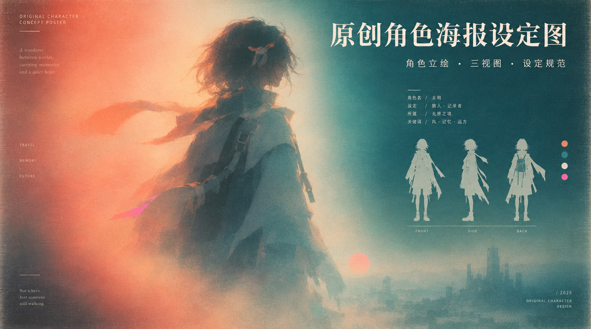
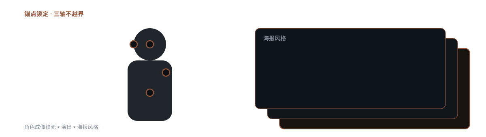

# domn-character-poster



> 把用户给的角色参考图，按指定方向（主视觉海报/人物设定图）出原创角色宣传物料，保证多张里是同一个人、同一套画风。

## 真实产出样例

下面是这个技能**实际会产出**的东西（抽自仓库内的 references/ 真实交付样例），不是抽象描述：

```text
角色锚点卡（逐字复用，双锁防换脸/换装，取自 Ember）：
### A 角色成像锁定
- 媒介：二维数字绘画；笔触：干净闭合黑轮廓线，线宽统一；
  上色：赛璐璐平涂分色，硬边单层阴影；光照：主光右上，硬边二分。
### B 视觉锚点
1. 面容：方圆脸；短平眉、眉尾略下压；琥珀色圆瞳；左颊三厘米旧疤。
3. 体型：约七头身，肩窄腰细；赤足穿半旧短靴（鞋头磨白）。
6. 配色：主色深炭灰；辅色铜褐；强调琥珀橙只现于瞳/领口滚边/铜哨。
7. 标志物：腰间裂开的铜哨——唯一发声物件与"已用过一次"的叙事证据。
主视觉海报 prompt 编译：角色锁定(最高优先，不被改写)＋演出(战斗招式·低角度仰拍)
＋海报风格(电影一页式·标题块/主视觉/billing block)＋负向(禁改成像与配色、禁泛词)。
```

## 是什么

把用户给的角色参考图，按指定方向（主视觉海报/人物设定图）出原创角色宣传物料，保证多张里是同一个人、同一套画风。 本仓库是一个 Agent 技能（SKILL.md 为唯一权威定义），把上面的方法论沉淀为可被对话触发的可执行流程。

## 为什么不同

三轴互不越界(角色成像锁死 > 演出 > 海报风格)，参考图 i2i＋角色锚点卡双锁防换脸换装，海报风格不得改角色配色；强制「拒绝平庸自证」——每个选择都要答出为什么最抓眼球。

## 怎么做（工作流）

<p align="center">
  
</p>

> 角色成像锁死 > 演出 > 海报风；拒绝平庸自证

1. **门槛检查** — 无参考图即停；收齐参考图+设定+文字档位
2. **角色锁定** — 读成像锁定(5维)+视觉锚点(7项)，逐字复用
3. **定演出** — staging/ 推 2–3 档(能力类型×海报风格)，命中即套
4. **定海报风格** — styles/ 查画风库，命中套用/未命中现生成
5. **定输出方向** — 用户指定 keyvisual/sheet，两个都要则分两次
6. **组装交付** — 三段各落各的编译 prompt，逐张过骨架自检(≤800字)

## 怎么用

将本仓库放入支持 `SKILL.md` 的 Agent 技能目录：

- **WorkBuddy**：`~/.workbuddy/skills/domn-character-poster/`
- **Codex / 其他**：对应 skills 目录

然后在对话中触发，例如：

```
用 domn-character-poster 给 Ember 做一张战斗姿态主视觉海报，要求赛璐璐平涂风格不变。
```

## 依赖

纯提示词方法论 + references/ 弹药库；生视频依赖文生视频模型（即梦 Seedance / Kling / 可灵等），提示词喂给这些模型执行。

## 仓库结构

```
domn-character-poster/
├── SKILL.md                 # 技能定义（唯一权威）
├── assets/                  # 模板 / 占位素材
├── references/              # 方法论弹药库
└── assets/readme/           # 本 README 的视觉资产（hero.webp / workflow.svg）
```

## 许可

本仓库内容以 `SKILL.md` 为唯一权威定义。如附带 `LICENSE` 文件，以其为准。

---

*README 由 `beautify-github-readme` 生成 · 封面图来自作者作品集，强调色由封面采样派生；工作流图为每技能独立 motif。*